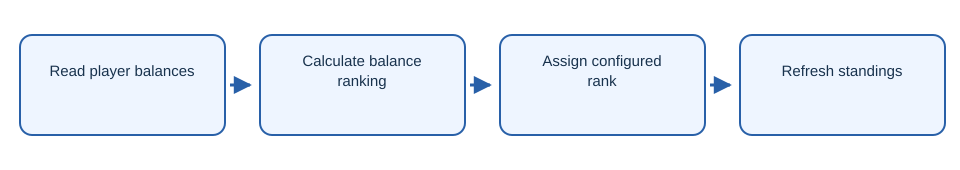

# BaltopRank

Minecraft plugin that assigns ranks from player balance standings.

## Workflow

1. Read player balances.
2. Calculate balance ranking.
3. Assign configured rank.
4. Refresh standings.

## Getting started

Build with `mvn package` and install the JAR on a compatible Minecraft server.

## License

The project code is licensed under AGPL-3.0-only. See [LICENSE](LICENSE).
